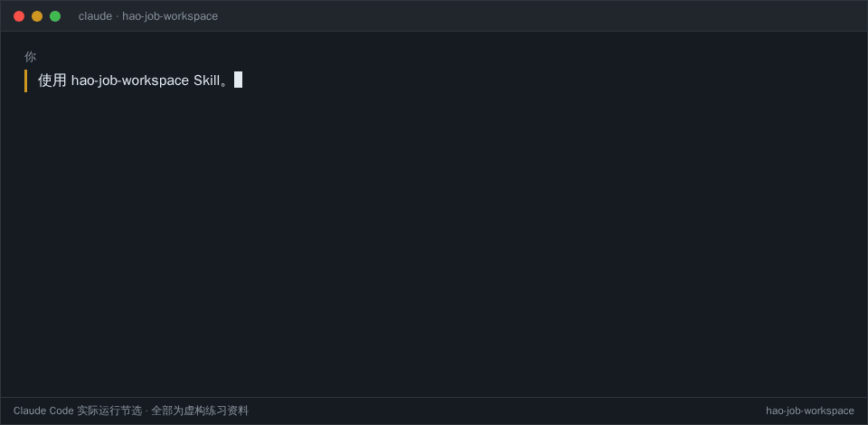

# HaoJob

[简体中文](README.md) · **English**

Let **Claude Code** or **Codex** use your own materials to find jobs, edit resumes, apply, track results, and prepare for interviews. Every statement names the source it rests on; anything without support stays out of your resume.



> Alpha: nobody outside the project has tried it yet. See the [environment notes](docs/supported-environments.md) for what has been tested and the [roadmap](ROADMAP.md) for plans. Most linked guides and templates are in Chinese; ask the agent to explain them.

## Quick start

You need Claude Code or the Codex desktop app, plus Git and Python 3.10+.

```sh
git clone https://github.com/HaoPan036/hao-job.git
cd hao-job
claude          # with Codex, open this folder in the app instead
```

Then tell the agent one thing.

**Use your own materials**: in Claude Code, type `/setup` followed by your resume. In Codex, say "set up my job-search materials" and paste your resume.

```text
/setup
[paste your resume or project history here]
```

The agent creates an empty workspace, confirms `private/` stays out of Git, turns your resume into a profile and fact cards, and ends with a list of questions for you to confirm. After that, ask for what you need; see [the next section](#what-you-can-do).

**See it work first**: to try it without real materials, use the fictional ones in the repository.

```text
Use the hao-job Skill.
The project notes are in examples/walkthrough/source.md.
The job description is in examples/walkthrough/target-role.md.
Based on those materials, write one resume bullet in Chinese and English.
Then help me explain this project in an interview, in English.
Separately show which source supports each important statement
and what still needs confirmation.
Reply in this conversation; do not modify any files.
```

For manual setup, using the Skill from another folder, or pairing it with Obsidian, see [More documentation](#more-documentation).

## What you can do

The steps share your materials and application records; use any one of them. Ask for the outcome you need:

| Step | Example request |
| --- | --- |
| **Find jobs** | “Find a few jobs that match my preferences. Open the official listings and tell me which are worth applying to. Don't save anything or apply yet.” |
| Save the results | “Add the jobs we just checked to my application queue. Explain why the others don't fit, and don't add jobs I've already applied to.” |
| Check your claims | “Compare my resume with my project notes. Flag anything that sounds overstated, and ask me about anything you can't confirm.” |
| **Tailor a resume** | “Here are my resume and the job description. Improve the project section to emphasize relevant work, without adding things I haven't done.” |
| **Apply** | See [Apply](#apply) |
| Count applications | “How many jobs have I applied to? Split internships and full-time roles.” |
| Follow up | “This role sent me an interview invitation. Here is the message. Verify it and update my records and next actions; don't reply for me.” |
| Plan today | “Check my queue and confirmed deadlines. Tell me what to do first today; don't change my records yet.” |
| **Prepare for interviews** | “I'm interviewing for this role. Help me explain this project and prepare for likely follow-up questions.” |
| Study technical questions | “What technical questions might come up for this role? Explain the topics I'm less familiar with, then quiz me.” |
| Mock interview | “Act as the interviewer and ask about my resume, one question at a time. After each answer, tell me what was unclear and how I could answer better.” |

For bilingual materials, add: “Give me Chinese and English versions that describe the same responsibilities and results.”

The agent names the source for each important statement and lists anything still unconfirmed. For example, from this [fictional project record](examples/timeout/source.md):

> Record: I wrote the retry and stop rules. The program timed out, retried once, timed out again, and stopped.
>
> AI draft: “Solved the performance problem.”
>
> Revised against the record: “Added retry and stop rules; the program stopped after both attempts timed out.”

## Apply

Applying starts with your authorization of a specific position. After the AI fills the form and uploads your files, a separate independent agent checks the actual page and attachments, then submits once. Registration, login, and questions it cannot answer come back to you.

```text
I authorize applying to this specific position: [official URL and job ID].
Use the materials I have specified and confirmed in private/,
and this approved resume: [file path].
After filling the form and uploading the resume, hand the actual page
to an independent agent for review. If it passes, that agent should submit once.
Then verify the result, update my records, archive the resume actually used,
and report the application count.
Pause if I need to register, log in, or provide an unknown answer.
Do not apply to other positions.
```

- To stop before submission, say “fill only; do not submit.”
- If the result is uncertain, the agent does not resubmit or count it as a success. If the website confirms success but local records fail, it repairs the records without resubmitting.
- Filling, uploading, or saving a draft sends data to the recruiting website before final submission.

Browser work uses the host's browser control; the full chain has run on a local mock website with Codex and Chrome. You can try the [mock application](examples/application/README.md) first. The full procedure is in the [application guide](docs/applications.md).

## How it is put together

This repository is a set of instructions and tools used inside an agent, taken from the workflow the maintainer has used throughout their own job search.

| Part | Location | Purpose |
| --- | --- | --- |
| Skill | [`.agents/skills/hao-job/`](.agents/skills/hao-job/SKILL.md) | Instructions for the agent: pick the step your request needs and carry it out |
| Your materials | `private/` | Profile, fact cards, application records, and archived resumes; all ignored by Git |
| Templates and examples | [`templates/`](templates/), [`examples/`](examples/) | Blank templates and fictional examples |
| Tools | [`tools/`](tools/) | Standard-library Python scripts, called by the agent or run by hand |

Common read-only commands:

```sh
python3 tools/recruiting-sync/sync.py audit --json     # application counts
python3 tools/job-radar/funnel.py --root . --json      # queue overview
```

## More documentation

| To do this | Read |
| --- | --- |
| Set up by hand; check that `private/` is ignored | [Workspace setup tool](tools/workspace/README.md) |
| Use the Skill from a folder outside this repository | [Install notes](tools/skill-install/README.md) |
| Collect jobs automatically from sources you configure | [Discovery tool](tools/job-radar/README.md) |
| Synchronize application records and counts | [Sync tool](tools/recruiting-sync/README.md) |
| Work through a full exercise with reference answers | [Walkthrough](examples/walkthrough/README.md), [interview example](examples/walkthrough/interview-cycle.md) |
| Supported systems, file formats, Obsidian | [Environment notes](docs/supported-environments.md) |
| Where your data goes | [Data-flow notes](docs/privacy-and-data-flow.md) |
| Check the repository itself | `python3 tools/repo-check/check.py` |

## Data, license, and feedback

Keep real materials in `private/` only; do not commit them to the public repository or include them in issues. What the agent reads is processed by its model service.

Original content is available under the [MIT License](LICENSE). See the [sources](docs/sources.md).

After trying it, report through [GitHub Issues](https://github.com/HaoPan036/hao-job/issues/new) using the [tryout template](docs/tryout.md).

## Related projects

The comparisons below are based on documentation read on **2026-10-02**.

| Project | Its focus | This package's current scope |
| --- | --- | --- |
| [AARG](https://github.com/joseym/aarg/blob/7300fdf8a3c5b0bc2132288d16cc59c382a3ec1d/README.md) | Tailors resumes to job descriptions and generates PDFs; code restricts new numbers and unsupported skills | Uses existing materials for resume text and interview answers |
| [ResumeProof](https://github.com/caihhhhhh/resume-proof/blob/0213db759582da9addbcf1e142ace92a5d95a0dd/README.md) | Organizes resume edits, text approval, and document delivery checks with a Skill and Python tools | Primarily Markdown and plain text |
| [LLMInternSkill](https://github.com/wanyichen06/LLMInternSkill/blob/e57ec94d8810dfeed8dec2c5fc515f0fbaa0a933/README.md) | Resume editing, matching, project evidence review, and interview follow-ups for LLM-related internships | Also uses project evidence; includes reviewing actual answers and practicing one question at a time |
| [Career OS](https://github.com/sean2077/career-os/blob/370274792e6259d5b874ec627c5e31140309f03c/README.md) | An Obsidian and agent workspace for career materials, direction, opportunities, and preparation, with CLI checks | Also uses local materials; includes independently reviewed submission, result synchronization, and archiving the resume used |
| [job-search-pack](https://github.com/nikhilvdev/job-search-pack/blob/d603672432ad67d5b26d1b320044d9cd1a05c980/README.md) | Five Skills for resumes, cover letters, LinkedIn, salary negotiation, and application tracking | One entry-point Skill routes requests to the relevant workflow and shares materials and application records |
| [Guild](https://github.com/arafa-dev/ai-job-application-automation/blob/de8cc9343bd046613b1f4b59e436fb517eb93131/README.md) | Job discovery, matching, materials, tracking, and form filling, with final submission by the user | After authorization for a specific position, an independent agent reviews the actual form and submits if it passes |
| [JobSpy](https://github.com/speedyapply/JobSpy/blob/10b5417c8f2c99a6159733cf0f52a06c96c3832d/README.md) | Collects jobs from multiple sites into tabular data | Host search and official checks, with optional source collection, deduplication, and queue checks |
| [OfferPilot (offercontext/offerPilot)](https://github.com/offercontext/offerPilot/blob/c0a447bbe7be8976fe9a53c2bcbf3b91dad0eeac/README.md) | A local job-search workspace for applications, resumes, and interviews; its README excludes automatic applications and recruiter outreach | Includes instructions for authorized automatic submission after independent review |
