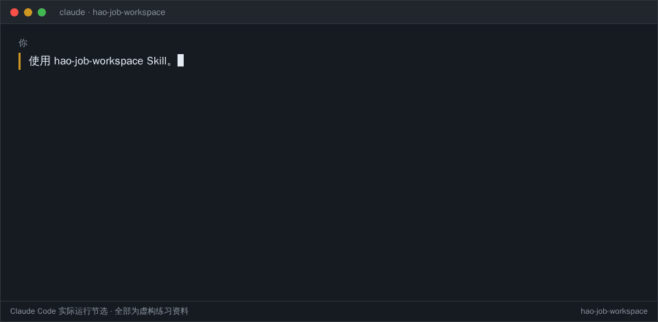

# HaoJob · 求职工作台

**简体中文** · [English](README.en.md)

让 **Claude Code** 或 **Codex** 用你自己的资料找岗位、改简历、投递、记录结果和准备面试。每句话都标出依据哪份资料，没依据的不往简历里写。



> 早期版本（Alpha）：还没有陌生用户试用过。测过什么见[环境说明](docs/supported-environments.md)，计划见 [ROADMAP](ROADMAP.md)。

## 快速开始

需要 Claude Code 或 Codex 桌面应用，以及 Git 和 Python 3.10+。

```sh
git clone https://github.com/HaoPan036/hao-job.git
cd hao-job
claude          # 用 Codex 时改为在应用里打开这个文件夹
```

然后对 Agent 说一句话。

**用自己的资料**：在 Claude Code 里输入 `/setup`，后面直接贴上简历；用 Codex 时说“帮我初始化求职资料”，再贴简历。

```text
/setup
[把简历或项目经历贴在这里]
```

Agent 会建好空档案、确认 `private/` 不进 Git、把简历整理成档案和事实卡，最后列出需要你确认的问题。之后就可以直接提要求，见[下一节](#能做什么)。

**先看看效果**：不想贴真实资料时，用仓库里的虚构资料试一次。

```text
使用 hao-job Skill。
项目资料在 examples/walkthrough/source.md，
岗位要求在 examples/walkthrough/target-role.md。
请根据这些资料，帮我写一条可以放进简历的项目经历，再给一版英文。
然后帮我准备面试时怎么介绍这个项目。
写完后告诉我：这些说法分别根据哪段资料，还有哪些地方需要确认。
先把结果发在对话里，不要修改文件。
```

想手动初始化、在其他目录使用这个 Skill，或搭配 Obsidian，见[更多文档](#更多文档)。

## 能做什么

各环节共用你的资料和求职记录，可以只用其中一个。直接说想做什么：

| 环节 | 可以这样说 |
| --- | --- |
| **找岗位** | “按我的求职条件找几个岗位。打开官网核对要求，告诉我哪些值得投；先不要保存，也不要申请。” |
| 保存筛选结果 | “把刚才核实过的岗位整理进我的待办；不符合的写清原因，已经投过的别再加。” |
| 核对经历 | “对照我的项目笔记，看看简历里有没有夸大的地方。拿不准的地方标出来，问我。” |
| **改简历** | “这是我的简历和岗位要求，帮我改一下项目经历，突出与岗位有关的部分，不要加我没做过的事。” |
| **投递** | 见[投递](#投递) |
| 记录与统计 | “我一共投了多少个岗位？按实习和全职分开。” |
| 跟进进度 | “这个岗位发来面试邀请了。这是邀请内容，请核对并更新记录和待办，不用替我回复。” |
| 今日安排 | “看看我的待办和已确认的截止日期，告诉我今天先做哪几件事；先不要改记录。” |
| **面试准备** | “我要面试这个岗位。帮我准备怎么介绍这个项目，以及面试官可能追问什么。” |
| 八股文 | “这个岗位会问哪些技术问题？先从我不熟悉的知识讲起，再出题看看我有没有理解。” |
| 模拟面试 | “你来当面试官，根据我的简历一次问一道。等我回答后，告诉我哪里没说清楚、怎么答更好。” |

需要英文版时加一句：“再给我一版英文，职责和结果要与中文一致。”

Agent 会说明每个关键说法来自哪份资料、还有哪些没确认。例如这份[虚构项目记录](examples/timeout/source.md)：

> 资料：重试和停止规则由我编写；程序超时后又试了一次，还是超时，于是停止运行。
>
> AI 写成：解决了性能问题。
>
> 对照资料改成：为程序加上重试和停止规则，两次尝试都超时后停止运行。

## 投递

投递由你授权具体岗位开始。AI 填写并上传后，交给另一个独立 Agent 检查实际页面和附件，通过后提交一次；注册、登录和它答不了的问题交还给你。

```text
我授权投递这个具体岗位：[官网链接和岗位 ID]。
使用我在 private/ 中指定并确认的资料，以及这份简历：[文件路径]。
填写和上传后，请交给独立 Agent 检查实际页面；通过后由它提交一次，
再核对结果、更新记录、保存实际提交的简历并告诉我投递数量。
需要我注册、登录或补充未知答案时停下来；不要申请其他岗位。
```

- 只想填写时，直接说“只填不提交”。
- 无法确定是否提交成功时，不重试、不计为成功；网站已成功但本地没记上时，只补记录，不重复投递。
- 填写、上传或保存草稿时，内容会在最终提交前发给招聘网站。

网页操作使用宿主的浏览器能力，目前在 Codex 加本机 Chrome 的模拟网站上跑通过。可以先跑一次[模拟申请](examples/application/README.md)，完整步骤见[投递说明](docs/applications.md)。

## 它是怎么组成的

本仓库是一套在 Agent 里使用的规则和工具，来自维护者自己求职时长期在用的做法。

| 部分 | 位置 | 作用 |
| --- | --- | --- |
| Skill | [`.agents/skills/hao-job/`](.agents/skills/hao-job/SKILL.md) | 给 Agent 的操作规则：按你的请求选一个环节执行 |
| 你的资料 | `private/` | 档案、事实卡、投递记录和归档的简历；全部被 Git 忽略 |
| 模板与示例 | [`templates/`](templates/)、[`examples/`](examples/) | 空白模板和虚构示例 |
| 工具 | [`tools/`](tools/) | 纯标准库 Python 脚本，由 Agent 调用，也可以自己运行 |

常用的只读命令：

```sh
python3 tools/recruiting-sync/sync.py audit --json     # 投递数量
python3 tools/job-radar/funnel.py --root . --json      # 待投概况
```

## 更多文档

| 想做什么 | 看这里 |
| --- | --- |
| 手动初始化、检查 `private/` 是否被忽略 | [初始化工具](tools/workspace/README.md) |
| 在仓库以外的目录使用 Skill | [安装说明](tools/skill-install/README.md) |
| 从自己配置的来源自动采集岗位 | [找岗位工具](tools/job-radar/README.md) |
| 同步投递记录、统计数量 | [同步工具](tools/recruiting-sync/README.md) |
| 做一遍完整练习并对照参考答案 | [完整示例](examples/walkthrough/README.md)、[面试示例](examples/walkthrough/interview-cycle.md) |
| 支持的系统、资料格式、Obsidian | [环境说明](docs/supported-environments.md) |
| 资料会发到哪里 | [数据说明](docs/privacy-and-data-flow.md) |
| 检查仓库本身 | `python3 tools/repo-check/check.py` |

## 数据、许可与反馈

真实资料只放在 `private/`，不要提交到公开仓库或 issue。Agent 读取的内容会交给它的模型服务处理。

本包原创内容采用 [MIT](LICENSE)；来源见[来源说明](docs/sources.md)。

试用后请按[试用记录模板](docs/tryout.md)在 [Issues](https://github.com/HaoPan036/hao-job/issues/new) 反馈。

## 相关项目

以下对比根据 2026-10-02 的文档整理。

| 项目 | 对方主线 | 本项目当前范围 |
| --- | --- | --- |
| [AARG](https://github.com/joseym/aarg/blob/7300fdf8a3c5b0bc2132288d16cc59c382a3ec1d/README.md) | 按岗位要求定制简历并生成 PDF；代码对新增数字、缺少依据的技能做限制 | 用已有资料准备简历文字和面试回答 |
| [ResumeProof](https://github.com/caihhhhhh/resume-proof/blob/0213db759582da9addbcf1e142ace92a5d95a0dd/README.md) | 用 Skill 和 Python 工具组织简历修改、文本审批和文档交付检查 | 以 Markdown 和纯文本为主 |
| [LLMInternSkill](https://github.com/wanyichen06/LLMInternSkill/blob/e57ec94d8810dfeed8dec2c5fc515f0fbaa0a933/README.md) | 面向大模型相关实习，做简历修改、岗位匹配、项目证据审阅和面试追问 | 同样根据项目资料准备材料；公开版还包括回答复盘与逐题练习 |
| [Career OS](https://github.com/sean2077/career-os/blob/370274792e6259d5b874ec627c5e31140309f03c/README.md) | 用 Obsidian 和 Agent 管理职业资料、求职方向、岗位机会与能力准备，也提供命令行检查工具 | 同样使用本地资料；本包另有独立审查后提交、结果同步和原简历归档流程 |
| [job-search-pack](https://github.com/nikhilvdev/job-search-pack/blob/d603672432ad67d5b26d1b320044d9cd1a05c980/README.md) | 五个 Skill，分别处理简历、求职信、LinkedIn、薪资谈判和投递跟踪 | 一个 Skill 按请求分步骤处理，共用资料、记录和实际投递版本 |
| [Guild](https://github.com/arafa-dev/ai-job-application-automation/blob/de8cc9343bd046613b1f4b59e436fb517eb93131/README.md) | 找岗位、算匹配程度、生成材料、跟踪投递和填写表单；最终提交由用户完成 | 用户授权具体岗位后，独立 Agent 审查实际页面，通过后提交 |
| [JobSpy](https://github.com/speedyapply/JobSpy/blob/10b5417c8f2c99a6159733cf0f52a06c96c3832d/README.md) | 从多个招聘网站抓取岗位，整理成表格数据 | 宿主搜索与官网核验，另有可选来源采集、重复和保存检查 |
| [OfferPilot（offercontext/offerPilot）](https://github.com/offercontext/offerPilot/blob/c0a447bbe7be8976fe9a53c2bcbf3b91dad0eeac/README.md) | 本地求职工作台，管理投递记录、简历和面试准备等；README 明确不自动投递或联系招聘方 | 提供具体岗位授权后的自动投递规则 |
