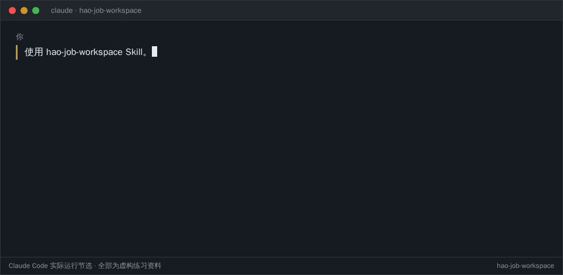

# HaoJob · 求职工作台

**简体中文** · [English](README.en.md)

HaoJob 让 **Codex** 或 **Claude Code** 帮你求职：找岗位、改简历、投递、记录结果、准备面试。它只用你自己的资料，写出的每句话都标明出处，你没做过的事不会写进简历。



> 早期版本（Alpha）：还没有项目以外的人试用过，建议先用仓库里的虚构资料试。

## 它是什么

HaoJob 不是一个要安装的软件，而是一份写给 AI 的求职操作手册（叫作 Skill），再加上空白模板和几个小工具。你在 Codex 或 Claude Code 里用平常的话说想做什么，AI 按手册去做。这套做法来自作者自己求职时一直在用的流程。

你的简历、项目笔记和投递记录都放在电脑上的 `private/` 文件夹里，这个文件夹不会被提交到 Git。

整个流程分四步，每一步都可以单独用：

```text
① 初始化资料 → ② 按求职条件找岗位 → ③ 授权后投递 → ④ 记录、跟进、准备面试
```

## 先试一次（5 分钟）

先用仓库自带的虚构资料试，不需要你的真实简历，也不用登录招聘网站。

需要准备：[Claude Code](https://code.claude.com/docs/en/setup)（在终端里用）或 Codex 桌面应用，外加 Git 和 Python 3.10 以上。目前在 macOS 和 Linux 上试过，Windows 还没试。

1. 在终端里下载仓库：

   ```sh
   git clone https://github.com/HaoPan036/hao-job.git
   cd hao-job
   ```

2. 用 AI 打开这个文件夹：
   - **Claude Code**：在同一个终端里运行 `claude`。
   - **Codex**：按[官方上手指南](https://learn.chatgpt.com/docs/quickstart)登录后，打开这个文件夹。

3. 把下面这段话发给它：

   ```text
   使用 hao-job Skill。
   项目资料在 examples/walkthrough/source.md，
   岗位要求在 examples/walkthrough/target-role.md。
   请根据这些资料，帮我写一条可以放进简历的项目经历，再给一版英文。
   然后帮我准备面试时怎么介绍这个项目。
   写完后告诉我：这些说法分别根据哪段资料，还有哪些地方需要确认。
   先把结果发在对话里，不要修改文件。
   ```

你会看到一条简历经历、对应的英文版和一段面试介绍，以及每句话来自哪段资料、哪些说法被有意删掉了。想继续练，可以做[完整示例](examples/walkthrough/README.md)。

如果 AI 说找不到这个 Skill，让它先读 `.agents/skills/hao-job/SKILL.md`。想在仓库以外的文件夹里也能用，看[安装说明](tools/skill-install/README.md)。

## 完整流程

### ① 初始化资料

**怎么做：** 在 Claude Code 里输入 `/setup`，用 Codex 时说“帮我初始化求职资料”。它会先建好 `private/` 并确认不会进 Git，再请你贴上简历，或把简历和项目笔记**复制**一份到 `private/inbox/`。真实资料等这一步确认过再放。

**AI 会做什么：**

1. 在 `private/` 里建好空白档案，并确认这个文件夹不会进 Git。
2. 读你的资料，把每段经历拆成一张张“事实卡”（一条说法一张，写明出自哪份资料）。
3. 问你几组问题：想找什么岗位、在哪些地区、各地区的工作许可、毕业和入职时间、每个项目里哪些是你亲手做的。可以跳过。
4. 把求职方向写进 `private/job-search/profile.json`，这就是第 ② 步找岗位用的条件。
5. 最后列出一份待你确认的清单。

**会卡在哪：**

- **PDF 和 Word 简历可能读不出来。** 目前 Markdown 和纯文本最稳；读不出时把简历另存为纯文本再给它。
- **从简历里读出来的说法都先算“未核实”。** 你逐条确认过的，才会用进正式简历；带数字的结果如果说不清怎么测的，会一直保持未核实。
- **工作许可、毕业时间不会替你猜。** 你不说就留空，第 ② 步遇到这些条件的岗位会转成人工判断。
- 如果检查发现 `private/` 没有被 Git 忽略，它会停下来，修好之前只用虚构资料。

想自己一步步来，看[初始化说明](tools/workspace/README.md)。

### ② 按求职条件找岗位

**怎么做：** 说“按我的求职条件找几个岗位，打开官网核对要求，告诉我哪些值得投；先不要保存，也不要申请。”

**AI 会做什么：**

1. 读 `profile.json` 里的岗位方向、地区和条件，用它自己的联网搜索找候选。
2. 每个岗位都去公司官网或正式招聘系统核对：还开不开放、要求是什么、你的工作许可和毕业时间是否符合。
3. 和你已投、已排队的岗位对比，去掉重复。
4. 每个岗位给出建议：现在投、攒一批投、需要你判断、先观察、跳过，并说明理由和该用哪版简历。
5. 默认只给你看。你说“保存”，它才把值得投的写进待投清单 `private/recruiting/queue.md`。

**可选：自动收集。** 想固定盯几家公司，可以在 `private/job-search/sources.json` 里登记它们的招聘页、RSS、Greenhouse、Lever 等地址，用 [Radar 工具](tools/job-radar/README.md)批量收集候选，再交给 AI 逐个核对。它不会直接排队或投递。

**会卡在哪：**

- **`profile.json` 是空的就没法找。** 先做第 ① 步，或直接告诉 AI 你的方向和地区。
- **AI 要能联网搜索。** 能不能搜、搜得多全，取决于你用的 Codex 或 Claude Code 账号和设置。
- **聚合站、公众号、旧截图只算线索。** 必须打开官方岗位页确认，否则不会建议你投。
- **条件不明的岗位不会自动放行。** 例如没写是否提供签证担保、你又没说明工作许可时，会标成需要你判断。
- **自动收集的来源一开始是空的**，要你自己填地址；它不支持需要登录或靠浏览器动态加载的页面，真实网站兼容性还没逐个验证。定时运行和变化监听是实验功能，只在 macOS 上做过模拟测试，见[后台服务说明](docs/experimental/background-service.md)。

### ③ 授权后投递

**怎么做：** 先跑一次[本机模拟投递](examples/application/README.md)：按说明在你电脑上启动一个假的招聘网站，让 AI 用虚构资料走完填表、检查、提交全过程，不会投给任何真实网站。这一步需要 AI 能操作浏览器。正式投递时要写清具体岗位：

```text
我授权投递这个具体岗位：[官网链接和岗位 ID]。
使用 private/ 中我确认过的资料，以及这份简历：[文件路径]。
填好后交给独立 Agent 检查实际页面，通过后提交一次，再更新记录。
需要我注册、登录或回答不确定的问题时停下来；不要申请其他岗位。
```

只想让它填表、不提交时，说“只填不提交”。

**AI 会做什么：**

1. 核对这个岗位以前有没有投过。
2. 打开网页，填表、上传你指定的简历。
3. 交给另一个 AI 检查实际页面：每个字段、勾选的声明、上传的附件，是否和你的授权和资料一致。
4. 检查通过后由它点一次提交，然后确认网站显示成功。不会再问你一遍“确定吗”。

**会卡在哪：**

- **注册、登录、验证码**要你自己来，它会停在那一页告诉你。
- **表单里有资料中没有的必填问题**（比如期望薪资、某个声明），它会停下来问你，不会编。
- **AI 要能操作浏览器。** 目前只在 Codex 加本机 Chrome 的模拟网站上跑通过；Claude Code 的网页操作和真实招聘网站都还没验证，可能会在具体网站上卡住。
- **安排不了第二个 AI 检查时**，只保留填好的草稿，不会自己检查完就提交。
- **提交后页面卡住、看不出成功没有时**，不会再点一次，也不计成功，先让你去网站上确认。
- 有些网站在填写或上传时就已经把内容发过去了，不是点提交才发。

详细步骤见[投递说明](docs/applications.md)。

### ④ 记录、跟进、准备面试

**AI 会做什么：**

- 确认投递成功后，更新投递历史和待投清单，统计投了多少，并存下当时提交的那版简历。
- 收到测评、面试、拒信或 Offer 时，把内容贴给它，它会核对并更新记录和下一步。它不会去读你的邮箱，也不会替你回复。
- 面试前说“找出这个岗位当时投的简历，按那份准备项目介绍”，它会找回当时的原件，而不是后来改过的版本。
- 准备项目介绍、可能的追问、技术题讲解，以及一问一答的模拟面试。

**会卡在哪：**

- 投递数量按地区分类统计，模板里的 Singapore / Canada 只是示例。`/setup` 时告诉它你在哪些地区找工作，它会改 `private/recruiting/config.json`；没改之前，其他地区的投递不会计入，统计会报问题。
- 统计结果里如果报了问题，要先处理，否则数字可能不完整。见[同步工具](tools/recruiting-sync/README.md)。

简历、求职信、面试准备和复盘的空白模板在 [templates](templates/)，串起来的用法见[面试示例](examples/walkthrough/interview-cycle.md)。

## 它怎么防止夸大

拿一个[虚构的例子](examples/timeout/source.md)：

> 资料：重试和停止规则由我编写；程序超时后又试了一次，还是超时，于是停止运行。
>
> AI 容易写成：解决了性能问题。
>
> 对照资料改成：为程序加上重试和停止规则，两次尝试都超时后停止运行。

AI 仍可能出错，用之前自己再看一遍。

## 隐私

不要把真实资料提交到公开仓库或 issue。资料存在本机，不代表 AI 读取后只在本机处理；填写网页表单时，内容在提交前就可能发给招聘网站。详见[数据说明](docs/privacy-and-data-flow.md)。

## 反馈与许可

试用后欢迎按[试用记录模板](docs/tryout.md)在 [Issues](https://github.com/HaoPan036/hao-job/issues/new) 反馈，请不要附真实简历。已测试和待验证的内容见[环境说明](docs/supported-environments.md)和[待验证清单](docs/validation-plan.md)，和同类项目的对比见[来源说明](docs/sources.md)。

本项目采用 [MIT](LICENSE) 许可。
